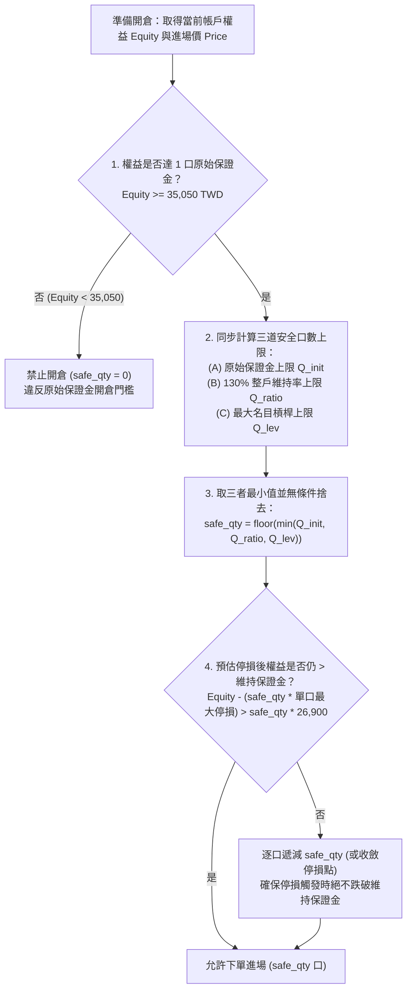
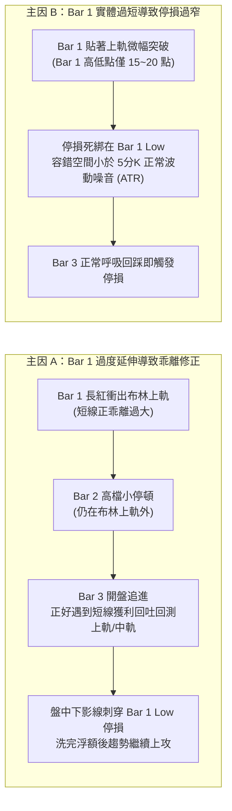

# 微台指 (TMFR1) 保證金維持率、真實槓桿與布林突破策略演進設計規格書

> **文件狀態**：架構設計與策略討論稿（尚未修改程式碼，供決策審閱）  
> **建立時間**：2026-10-15  
> **適用標的**：臺灣期貨交易所微型臺股期貨近月連續合約（`TMFR1`，每點價值 `10` TWD）  
> **基準本金**：`105,150` TWD｜**原始保證金**：`35,050` TWD / 口｜**維持保證金**：`26,900` TWD / 口

---

## 一、 真實合約總價值與槓桿倍數校正分析

### 1.1 合約總價值（Notional Contract Value）計算驗證
您的理解完全正確，先前討論中舉例之 `23,000` 點僅為舊制指數假設值；在我們目前資料庫（`2026-07-22 ~ 2026-10-14`）的真實歷史行情中，微台指（`TMFR1`）的實際進場價位區間落在 **`40,026.0` 點至 `50,205.0` 點**。

以您提出的進場價位 **`45,980` 點** 為基準，單口微台指的真實名目合約總價值計算公式為：

$$\text{Single Contract Value} = \text{Entry Price} \times \text{Point Value} = 45,980 \times 10 = 459,800 \text{ TWD}$$

### 1.2 期初本金 `105,150` TWD 下之真實槓桿倍數對照表
當指數位於 **`45,980` 點**（單口合約價值 `459,800` TWD），且帳戶權益（Equity）為期初本金 **`105,150` TWD** 時，不同持倉口數對應的真實財務數據如下：

| 持倉口數 (`Qty`) | 總合約名目價值 (`Notional Value`) | 真實名目槓桿 (`Notional Leverage`) | 佔用原始保證金 (`Qty × 35,050`) | 維持保證金底線 (`Qty × 26,900`) | 原始保證金維持率 (`Equity / 原始保證金`) | 維持保證金涵蓋率 (`Equity / 維持保證金`) |
| :--- | :--- | :--- | :--- | :--- | :--- | :--- |
| **1 口** | `459,800` TWD | **4.37 倍** | `35,050` TWD | `26,900` TWD | **300.00%** | **390.89%** |
| **2 口** | `919,600` TWD | **8.75 倍** | `70,100` TWD | `53,800` TWD | **150.00%** | **195.45%** |
| **3 口（滿倉）** | `1,379,400` TWD | **13.12 倍** | `105,150` TWD | `80,700` TWD | **100.00%** | **130.30%** |

> **關鍵發現**：
> 1. **為什麼預設模式（`notional`，最大槓桿上限 `7.0` 倍）永遠只下 1 口？**  
>    因為在 `45,980` 點時，下 **1 口** 的真實名目槓桿已經是 **4.37 倍**，若下 **2 口** 則高達 **8.75 倍**（超過設定的 `7.0` 倍上限），因此 `notional` 模式下系統自動將部位壓制在 **1 口**。
> 2. **為什麼「最佳化參數模式（`margin`）」槓桿會過高？**  
>    因為在 `margin` 模式下，程式直接用 `floor(105,150 / 35,050) = 3` 口滿倉進場，完全忽略了在 `45,980` 點時 3 口的總合約價值高達 **`1,379,400` TWD**（在 `50,205` 點時甚至達 `1,506,150` TWD），導致真實名目槓桿飆升至 **13.12 倍 ~ 14.32 倍**。

---

## 二、 `Math.max(1, ...)` 邏輯破綻疏通與修正規格

### 2.1 現有程式碼之問題診斷
目前在 [services/backtest/engine.py](file:///C:/Users/User/.gemini/antigravity/scratch/Quant/services/backtest/engine.py#L84-L88) 與 [generate_kline_dashboard.py](file:///C:/Users/User/.gemini/antigravity/scratch/Quant/generate_kline_dashboard.py#L4850-L4853) 中，`margin` 模式的寫法如下：

```python
# 現有問題代碼
raw_cap_qty = math.floor(self.equity / self.config.margin_req)
raw_lev_qty = math.floor((self.equity * self.config.max_leverage) / self.config.margin_req)
safe_qty = max(1, min(raw_cap_qty, raw_lev_qty))
```

這段邏輯存在 **兩個結構性破綻**：
1. **破綻一（違反開倉原始保證金硬性規定）**：  
   當帳戶因連續停損導致權益 `equity` 跌至 `34,000` TWD 時，`raw_cap_qty = floor(34,000 / 35,050) = 0` 口。但因為外層包了 `max(1, ...)`，系統仍會強行回傳 `safe_qty = 1` 口！在真實期貨交易中，可用權益低於原始保證金 `35,050` TWD 時，期貨商風控系統會直接拒絕委託單（Reject Order）。
2. **破綻二（分子分母錯置導致 `max_leverage` 失效）**：  
   `raw_lev_qty` 將 `(equity * max_leverage)` 除以 `margin_req (35,050)`，而不是除以「單口合約總價值 (`Price * 10`)」。這導致只要 `max_leverage >= 1.0`，`raw_lev_qty` 永遠大於等於 `raw_cap_qty`，使最大槓桿限制完全失去作用。

### 2.2 疏通後之正確邏輯流程
移除 `max(1, ...)`，並將開倉口數決策拆解為嚴格的 **階梯式風控過濾（Cascading Margin & Leverage Filter）**：



---

## 三、 原始保證金、維持保證金與「130% 整戶維持率」風控模型

您提到：**「原始保證金是開倉需要至少有這麼多，維持保證金為跌破這個強制平倉，我希望策略中嚴禁發生跌破維持保證金，且常用整戶擔保維持率維持在 `130%` 左右來衡量槓桿。」**

在量化期貨風控中，「`130%` 維持率」有兩種實務定義方式，我們將兩者的數學關係與口數影響完整列出，供您確認採用哪一種作為主基準：

### 3.1 定義對照：130% 維持率的兩種計算基準

#### 基準 A：以「原始保證金（`35,050` TWD）」為分母維持 `130%`（即期貨商「風險指標 $\ge 130\%$」）
- **公式**：
  $$\text{Margin Ratio}_{\text{init}} = \frac{\text{Equity}}{\text{Qty} \times 35,050} \ge 130\%$$
- **單口所需準備權益**：
  $$35,050 \times 130\% = \mathbf{45,565 \text{ TWD / 口}}$$
- **在期初本金 `105,150` TWD 下的表現**：
  - 最大可開倉口數：$\lfloor 105,150 / 45,565 \rfloor = \mathbf{2 \text{ 口}}$（若要求更保守的槓桿如 $\le 5$ 倍，則為 **1 口**）。
  - 開立 **2 口** 時，實際佔用原始保證金 `70,100` TWD，整戶維持率為 $\frac{105,150}{70,100} = \mathbf{150.0\%}$（大於 `130%`）。
  - **距離維持保證金（`26,900 × 2 = 53,800` TWD）之安全緩衝**：高達 **`51,350` TWD**（每口可承受 `2,567` 點逆勢波動），在正常停損機制下**100% 不可能跌破維持保證金**。

#### 基準 B：以「維持保證金（`26,900` TWD）」為分母維持 `130%`（即距離斷頭線保留 `30%` 安全邊際）
- **奇妙的數學巧合**：
  台灣期交所制定微台指保證金時，原始保證金與維持保證金的比例正好就是 `130.3%`：
  $$\frac{\text{原始保證金 } 35,050}{\text{維持保證金 } 26,900} = \mathbf{130.30\%}$$
- **含義**：
  如果您在滿倉 3 口（權益 `105,150` TWD，維持保證金總額 $26,900 \times 3 = 80,700$ TWD）時進場，進場瞬間的「權益 / 維持保證金」正好是 $\frac{105,150}{80,700} = 130.30\%$。但只要一進場出現 `247` TWD 的微小浮虧，維持率就會立刻掉到 `130%` 以下！
- **結論**：
  若要確保**「持倉期間（含遭遇最大停損時）整戶維持率仍維持在 `130%` 以上，且嚴禁跌破維持保證金」**，我們必須將 **預估停損金額 $L_{\text{SL}}$** 納入分母！

### 3.2 嚴禁跌破維持保證金之「雙重硬性約束公式」（推薦實作規格）

為了同時達成 **「降低槓桿倍數」**、**「維持率常態保持 $\ge 130\%$」** 與 **「嚴禁盤中跌破維持保證金 `26,900` TWD」**，建議在策略中採用以下三道硬約束：

1. **約束一（名目槓桿上限控制）**：
   將預設最大名目槓桿 `max_leverage` 從 `7.0 ~ 8.0` 倍調降至 **`4.5 倍 ~ 5.0 倍`**（在 `45,980` 點、本金 `105,150` 元時，穩健操作 **1 口**，真實槓桿 `4.37 倍`；直到帳戶權益成長至 `183,920` 元以上才自動晉升為 **2 口**）。
2. **約束二（130% 保證金維持率開倉門檻）**：
   規定開倉時，扣除該筆交易預估最大停損金額（$\text{Qty} \times L_{\text{SL}}$）後的最低預期權益，相對於維持保證金（$\text{Qty} \times 26,900$）必須仍 $\ge 130\%$（或相對於原始保證金 `35,050` 仍 $\ge 100\%$）：
   $$\frac{\text{Equity} - \text{Qty} \times L_{\text{SL}}}{\text{Qty} \times 26,900} \ge 130\% \implies \text{Qty} \le \left\lfloor \frac{\text{Equity}}{35,050 + L_{\text{SL}}} \right\rfloor$$
3. **約束三（盤中維持保證金生命線 — 零斷頭保護）**：
   在每一筆交易開倉時，自動計算該部位的 **「維持保證金強平警戒價（Maintenance Margin Stop Price）」**。若策略原本計算出的技術面停損價比維持保證金警戒價還要遠，系統強制將停損價收斂至維持保證金警戒價之內（並預留安全緩衝），從數學上保證**任何一筆交易在盤中觸及停損時，帳戶權益絕對高於 $\text{Qty} \times 26,900$ TWD**。

---

## 四、 布林突破策略：解決「乖離回調被掃停損」與「防範趨勢反轉」之架構藍圖

### 4.1 痛點本質剖析：為什麼「好位置開倉」卻常在第三根後被洗掉？

目前策略的進出場結構如下：
1. **Bar 1（突破棒）**：收盤突破布林上軌（`BB_Upper`）且為紅 K（多頭），或跌破布林下軌（`BB_Lower`）且為黑 K（空頭）。
2. **Bar 2（確認棒）**：收盤未破前高/前低，且守住 Bar 1 實體頂部 `25%`（或 `40%`）。
3. **Bar 3（進場棒）**：開盤市價進場，**盤中硬停損設在 Bar 1 的極端價（多頭設 `Bar 1 Low`，空頭設 `Bar 1 High`）**。

#### 造成「一進場就被乖離回調掃停損，隨後又往原方向走」的兩大主因：



---

### 4.2 四大策略改良模組設計（供您挑選與組合）

為了同時解決 **「不被初期的乖離回調洗出場」** 以及 **「避免放太久變成真反轉大賠」**，我設計了四個可獨立開關的策略模組：

#### 模組一：ATR 波動緩衝停損 + 布林中軌結構反轉停損（ATR-Buffered Stop + Mid-Band Structural Exit）
- **設計理念**：區分「盤中乖離修正雜訊」與「真正的趨勢反轉」。
- **具體規則**：
  1. **放寬盤中防洗盤停損（解決乖離回調被掃）**：  
     不再直接把停損緊貼在 `Bar 1 Low / High`，而是給予 $k \times \text{ATR}$ 的波動緩衝空間（或至少 $\ge 1.2 \times \text{ATR}$）：
     $$\text{SL}_{\text{long}} = \text{Bar1\_Low} - k \times \text{ATR}_{14} \quad (\text{建議 } k = 0.5 \sim 1.0)$$
     這樣當 Bar 3 ~ Bar 5 發生乖離回調、下影線微幅刺穿 Bar 1 低點時，不會被洗出場。
  2. **新增「收盤破布林中軌」結構停損（解決放太久趨勢反轉）**：  
     如果這波回調不是單純回踩，而是演變成**趨勢反轉**，價格必然會跌回布林通道內部並進一步跌破 **布林中軌（30 MA）**。因此規定：
     - **多單**：只要任一根 5 分 K **收盤價 `< 布林中軌 (BB_Mid)`**，無條件判定突破失敗、趨勢反轉，立即收盤平倉！
     - **空單**：只要任一根 5 分 K **收盤價 `> 布林中軌 (BB_Mid)`**，立即收盤平倉！

#### 模組二：黃金觀察期「時間停損（Time Stop / 動能計時器）」
- **設計理念**：真正的動能突破，即使經歷短暫乖離回調，也應該在有限時間內重新發動攻勢；若久盤不漲，必有反轉風險。
- **具體規則**：
  - 設定最大觀察棒數 $N_{\text{time}}$（例如 `6 ~ 8` 根 5 分 K，即進場後 `30 ~ 40` 分鐘）。
  - 當持倉滿 $N_{\text{time}}$ 根 K 棒時，若當前收盤價仍處於虧損狀態（或未脫離進場成本達 $+0.3 \times \text{ATR}$ 以上），代表多頭/空頭動能已經衰竭，不再等待，立即平倉離場，防止盤久必跌的趨勢反轉。

#### 模組三：第一根過度乖離過濾器 + 回踩限價進場（Over-Extension Filter & Pullback Entry）
- **設計理念**：既然知道「第一根超出布林軌道乖離過大時，後面一定會回調」，那就不要在高點市價追進，而是**等它回調時才進場**，或直接過濾掉過度噴出的極端棒。
- **具體規則**：
  1. **乖離率上限過濾**：計算 Bar 1 長度與布林軌道距離。若 $\text{Bar 1 Range} > 2.5 \times \text{ATR}_{14}$（代表第一根已經把短線空間走完），則：
     - **選項 3A（放寬 Bar 2 拉回深度）**：允許 Bar 2 拉回至 Bar 1 實體的 `50% ~ 65%`（原本只允許 `25%`），等乖離修正完畢後在 Bar 3 以更低成本進場。
     - **選項 3B（Bar 3 限價回踩進場）**：Bar 3 不在開盤價直接市價追進，而是掛限價單在 `Bar 1 收盤價回退 30% ~ 50%`（或布林上軌位置）接刀；若回調下來就買在漂亮低點（停損距離瞬間縮減一半），若沒回調則不追高。

#### 模組四：兩階段移動保本鎖利（Two-Stage Breakeven & Trailing Lock）
- **設計理念**：度過乖離回調並開始獲利後，絕不允許單子因為後續趨勢反轉而從「賺錢變賠錢」。
- **具體規則**：
  - **第一階段（剛進場）**：使用較寬的 `Bar 1 極值 ± ATR 緩衝` 停損，容忍初期乖離回調。
  - **第二階段（脫離成本區後）**：一旦持倉期間最高浮盈達到 $+1.2 \times \text{ATR}$（例如約 `+35 ~ +45` 點），立即將停損價強制移動至 **「進場成本價 $\pm 5$ 點（覆蓋手續費與稅金之保本價）」**。如此一來，即便後續發生大級別趨勢反轉，最差也是小賺保本出場。

---

## 五、 綜合決策檢核表（供您思考後勾選調整方向）

當您思考完畢後，只需告訴我以下幾個參數偏好，我即可為您同步實作至 Python 回測引擎與 GitHub Pages 互動儀表板：

1. **槓桿與保證金控管設定**：
   - [ ] **最大名目槓桿上限（`max_leverage`）**：建議設為 `4.5` 倍（`105,150` 元本金於 `45,980` 點固定下 `1` 口）或 `9.0` 倍（最多 `2` 口）？
   - [ ] **130% 整戶維持率公式**：採用 **「權益 / 原始保證金 $\ge 130\%$（每口需備妥 `45,565` 元）」**，還是 **「(權益 - 預估停損) / 維持保證金 $\ge 130\%$」**？
   - [ ] **盤中跌破維持保證金防護**：開啟「嚴禁跌破 `26,900` 元維持保證金」之開倉檢核與停損收斂保護。

2. **乖離回調與防反轉策略模組（可複選）**：
   - [ ] **模組一**：停損加上 `k × ATR` 緩衝（防乖離回調掃損）＋ 5 分 K 收盤跌破「布林中軌」立即出場（防趨勢反轉）。
   - [ ] **模組二**：進場滿 `N` 根 K 棒（如 8 根 = 40 分鐘）未獲利即啟動「時間停損（Time Stop）」。
   - [ ] **模組三**：當 Bar 1 乖離過大時，放寬拉回確認比例（如 `25% -> 50%`）或改採回踩布林軌道進場。
   - [ ] **模組四**：浮盈達 `1.2 × ATR` 後自動將停損推至「保本價（Breakeven）」。
